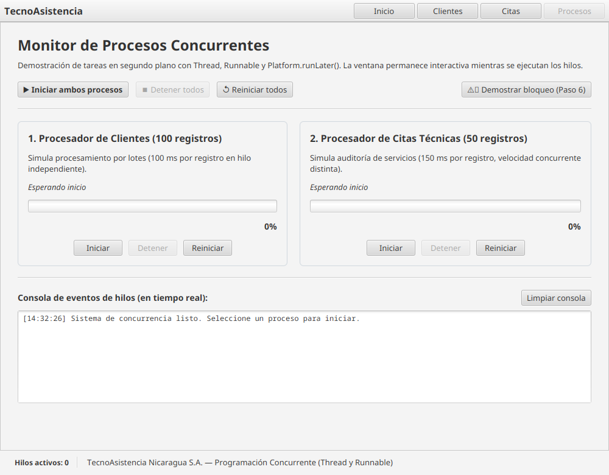

# TecnoAsistencia — Gestión de citas técnicas

Aplicación de escritorio para registrar clientes y administrar citas de atención técnica. El proyecto está desarrollado en Java 21 con JavaFX, FXML y PostgreSQL mediante JDBC en NeonDB, incorporando programación concurrente mediante hilos (`Thread` y `Runnable`).

## Funcionalidades

- Registrar, buscar, consultar, editar y eliminar clientes.
- Registrar citas vinculadas a clientes existentes, filtrar por fecha y estado, consultar, editar y eliminar citas.
- Validar campos obligatorios y el formato del correo; normalizar espacios al inicio y al final de nombres y apellidos.
- Elegir el tipo de servicio y el estado desde opciones disponibles, y evitar agendar citas en fechas anteriores al día actual.
- Mostrar confirmaciones antes de eliminar y bloquear la eliminación de clientes que aún tienen citas asociadas.
- Mantener las tablas sincronizadas con los cambios guardados en PostgreSQL (NeonDB).
- **Programación concurrente y multihilo:** Ejecución de consultas de base de datos y tareas por lotes en segundo plano con `Thread` y `Runnable`, actualizando controles de interfaz gráfica mediante `Platform.runLater()` sin bloquear el `JavaFX Application Thread`.
- **Monitor de Procesos Concurrentes (Reto Final UAM):** Ejecución paralela de dos hilos independientes (100 registros de clientes a 100 ms y 50 citas técnicas a 150 ms) con barras de progreso individuales, detención controlada (`interrupt()`), reinicio y consola de eventos en tiempo real.

## Requisitos

- JDK 21 (Eclipse Temurin o compatible).
- PostgreSQL local o una base de datos PostgreSQL en NeonDB.
- Conexión a Internet para sincronización con NeonDB y dependencias Maven la primera vez.

## Configurar PostgreSQL / NeonDB

1. Crea una base de datos de desarrollo en PostgreSQL o usa una base en NeonDB (usualmente llamada `neondb`).
2. Configura `src/main/resources/database.properties` (o `database.properties` en la raíz). Ese archivo está excluido de Git para proteger credenciales:

   ```properties
   db.url=jdbc:postgresql://HOST:5432/BASE_DE_DATOS?sslmode=require
   db.user=USUARIO
   db.password=CONTRASEÑA
   ```

   Para PostgreSQL local, puedes usar `jdbc:postgresql://localhost:5432/gestion_citas` y quitar `?sslmode=require`.
3. Ejecuta el script `gestion_citas.sql` para crear las tablas `cliente`, `cita_tecnica`, claves foráneas, restricciones de integridad e índices.
4. Ejecuta el programa y verifica que se conecta exitosamente a la base configurada.

## Programación Concurrente con Hilos (JavaFX)

Siguiendo las pautas pedagógicas de la **Unidad III: Programación concurrente** de la Universidad Americana (UAM), la aplicación implementa concurrencia en dos áreas clave:

### 1. Monitor de Procesos Concurrentes (`ProcesosController.java`)
Disponible desde la barra de herramientas ("Procesos") o la pantalla de inicio:
- **Proceso 1 (Clientes):** Procesa 100 registros simulados a una velocidad de 100 ms por iteración en el hilo `"Hilo-Procesamiento-Clientes"`.
- **Proceso 2 (Citas Técnicas - Reto Final):** Procesa 50 registros a 150 ms por iteración en el hilo `"Hilo-Procesamiento-Citas"`.
- **Independencia concurrente:** Cada proceso posee su propia `ProgressBar`, etiqueta de estado, etiqueta de porcentaje y botones individuales (`Iniciar`, `Detener`, `Reiniciar`), impidiendo que un hilo se inicie dos veces de forma simultánea.
- **Control global:** Permite iniciar o detener ambos procesos concurrentemente para evidenciar cómo dos hilos con distintas velocidades corren en paralelo sin degradar la capacidad de respuesta de la ventana.
- **Detención controlada:** Utiliza `interrupt()` y evalúa `Thread.currentThread().isInterrupted()`, capturando `InterruptedException` para detener el hilo limpiamente.
- **Gestión del ciclo de vida:** Implementa `detenerAlCerrar()` vinculado al evento `stage.setOnCloseRequest(...)` de la ventana para interrumpir cualquier hilo activo al salir de la aplicación.
- **Actualizaciones seguras de UI:** Todas las modificaciones a `ProgressBar`, `Label` y `TextArea` se realizan mediante `Platform.runLater()`.

### 2. Operaciones JDBC asíncronas (`Ui.ejecutar`)
Las consultas y modificaciones a NeonDB se ejecutan en segundo plano en el hilo daemon `"Hilo-ConsultaPostgreSQL"` usando `Runnable`. Los resultados y diálogos de error o confirmación se despachan al `JavaFX Application Thread` con `Platform.runLater()`, asegurando que la latencia de red no congele la ventana.

### 3. Paquete canónico de la práctica guiada (`ni.edu.uam.practicahilos`)
Para validar de forma directa la estructura solicitada en la guía de clase, se incluye el paquete `ni.edu.uam.practicahilos` con:
- `MainApp.java`: Punto de entrada JavaFX con gestión de cierre en el Stage.
- `ProcesadorController.java`: Controlador que implementa el caso de estudio de NicaData Solutions y el reto integrador.
- `procesador-view.fxml`: Vista con barras de progreso e interfaz interactiva.

## Ejecutar y probar

Desde la raíz del proyecto con Maven:

```bash
./mvnw clean javafx:run
```

En Windows puedes usar `mvnw.cmd clean javafx:run`. Para ejecutar la suite completa de pruebas automatizadas (concurrencia, interfaces y base de datos):

```bash
./mvnw test
```

Para ejecutar específicamente las pruebas de hilos y concurrencia:

```bash
./mvnw test -Dtest=HilosConcurrenciaTest
```

## Capturas

Las imágenes muestran las cuatro pantallas principales de la aplicación:

### Inicio


### Gestión de clientes


### Gestión de citas


### Monitor de Procesos Concurrentes (Hilos)


## Equipo

| Integrante | GitHub | Responsabilidad principal |
| --- | --- | --- |
| Roberto F. Tercero | [@robertofabiot](https://github.com/robertofabiot) | Base de datos, conexión JDBC y programación concurrente con hilos |
| Alfredo Jarquín | [@Jarquin23](https://github.com/Jarquin23) | Modelo y acceso a datos de clientes |
| Rommel Muñoz | [@Rommel110207](https://github.com/Rommel110207) | Modelo y acceso a datos de citas |
| Rodolfo Collado | [@rodolfo-collado](https://github.com/rodolfo-collado) | Interfaz JavaFX y experiencia de usuario |

## Lista de aceptación para la defensa

- [ ] Registrar un cliente y comprobar que aparece en la tabla.
- [ ] Intentar registrar un correo duplicado y comprobar el mensaje de rechazo.
- [ ] Modificar el teléfono de un cliente y verificar que el cambio persiste en PostgreSQL.
- [ ] Registrar una cita asociada a un cliente y verificar que su nombre aparece en la tabla de citas.
- [ ] Buscar un cliente por una coincidencia parcial de apellido sin distinguir mayúsculas y minúsculas.
- [ ] Filtrar citas por estado y fecha; limpiar los filtros y comprobar que vuelven a mostrarse los registros.
- [ ] Cambiar el estado de una cita a `Finalizada`.
- [ ] Intentar eliminar un cliente con citas asociadas y comprobar que la aplicación explica por qué no se puede.
- [ ] Eliminar una cita y después su cliente, confirmando ambos diálogos.
- [ ] **Iniciar el procesamiento concurrente de clientes y citas técnicas simultáneamente.**
- [ ] **Mover, redimensionar o interactuar con la ventana durante el procesamiento sin que se congele.**
- [ ] **Detener un hilo individualmente a mitad de ejecución y comprobar que el otro continúa su avance.**
- [ ] **Reiniciar el progreso y ejecutarlo nuevamente hasta el 100%.**
- [ ] **Cerrar la aplicación y verificar que los hilos activos se interrumpen y detienen de forma segura.**
