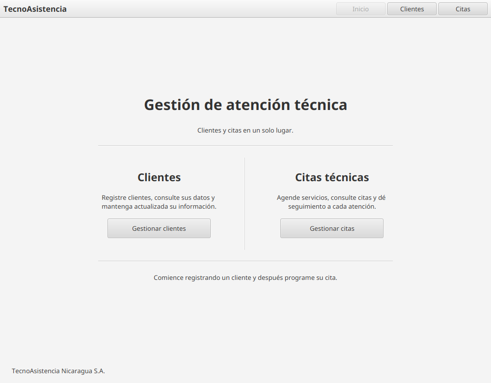
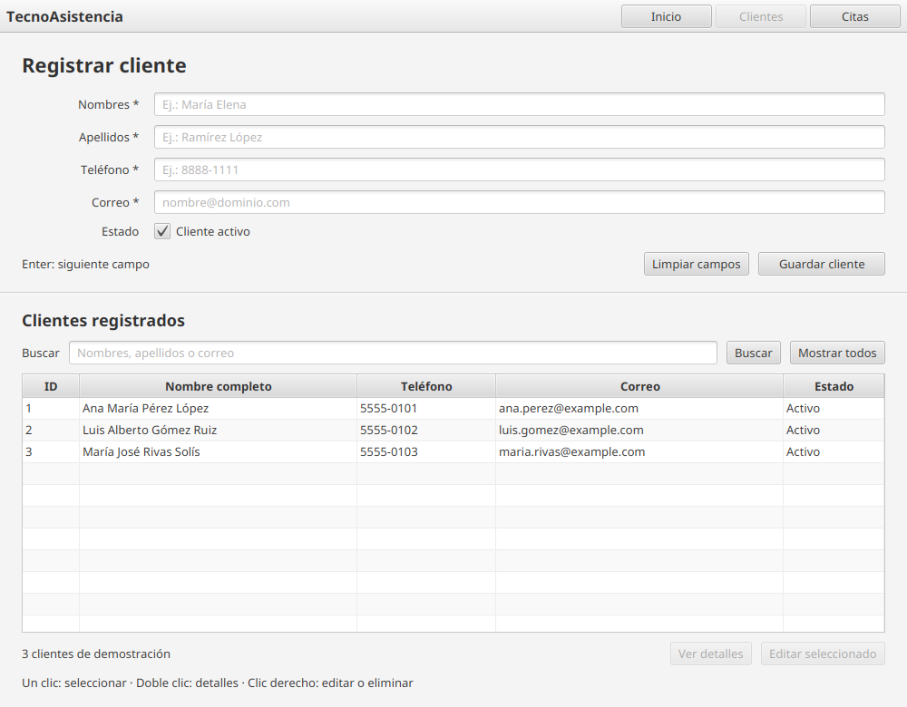
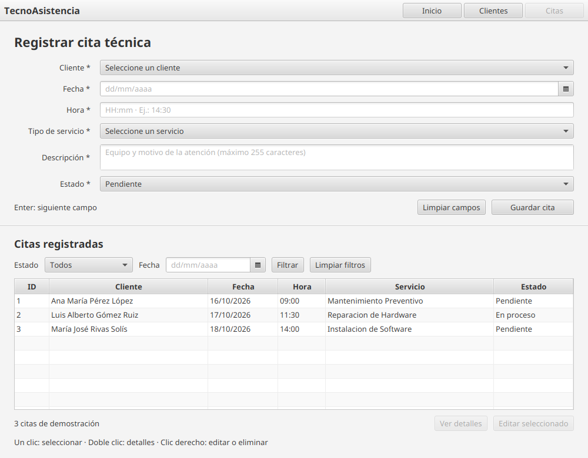

# TecnoAsistencia — Gestión de citas técnicas

Aplicación de escritorio para registrar clientes y administrar citas de atención técnica. El proyecto está desarrollado en Java 21 con JavaFX, FXML y PostgreSQL mediante JDBC.

## Funcionalidades

- Registrar, buscar, consultar, editar y eliminar clientes.
- Registrar citas vinculadas a clientes existentes, filtrar por fecha y estado, consultar, editar y eliminar citas.
- Validar campos obligatorios y el formato del correo; normalizar espacios al inicio y al final de nombres y apellidos.
- Elegir el tipo de servicio y el estado desde opciones disponibles, y evitar agendar citas en fechas anteriores al día actual.
- Mostrar confirmaciones antes de eliminar y bloquear la eliminación de clientes que aún tienen citas asociadas.
- Mantener las tablas sincronizadas con los cambios guardados en PostgreSQL.

## Requisitos

- JDK 21.
- PostgreSQL local o una base de datos PostgreSQL en Neon.
- Conexión a Internet para descargar dependencias Maven la primera vez.

## Configurar PostgreSQL

1. Crea una base de datos de desarrollo en PostgreSQL o usa una base de Neon. En Neon, la base predeterminada suele llamarse `neondb`.
2. Crea `src/main/resources/database.properties` en tu copia local del proyecto. Ese archivo está excluido de Git. Añade tus propias credenciales:

   ```properties
   db.url=jdbc:postgresql://HOST:5432/BASE_DE_DATOS?sslmode=require
   db.user=USUARIO
   db.password=CONTRASEÑA
   ```

   Para PostgreSQL local, normalmente puedes usar `jdbc:postgresql://localhost:5432/gestion_citas` y quitar `?sslmode=require`. Sustituye todos los valores de ejemplo por los de tu entorno; no publiques contraseñas ni agregues el archivo local al repositorio.
3. Abre `gestion_citas.sql` en el editor SQL de Neon o ejecútalo conectado a tu base PostgreSQL de desarrollo para crear las tablas e insertar registros de muestra.
4. Ejecuta el programa y verifica que puede conectarse a la base configurada.

> **Cuidado con el script SQL:** `gestion_citas.sql` elimina y vuelve a crear las tablas `cita_tecnica` y `cliente`. Esto borra los datos existentes de esas tablas. Ejecútalo únicamente en una base nueva o descartable; no lo ejecutes en producción ni en una base compartida con datos que quieras conservar.

La conexión busca primero `src/main/resources/database.properties` y `database.properties`; no es necesario cambiar credenciales dentro del código fuente.

## Ejecutar y probar

Desde la raíz del repositorio:

```bash
./mvnw clean javafx:run
```

En Windows puedes usar `mvnw.cmd clean javafx:run`. Para ejecutar las pruebas automatizadas:

```bash
./mvnw test
```

Las pruebas de persistencia necesitan una base PostgreSQL accesible con el esquema creado. Las pruebas de interfaz JavaFX necesitan una pantalla disponible; en Linux sin entorno gráfico pueden omitirse automáticamente.

## Capturas

Las imágenes muestran las tres pantallas principales. Las tablas contienen datos ficticios de demostración y no representan registros consultados de una base real.

### Inicio



### Gestión de clientes



### Gestión de citas



## Equipo

| Integrante | GitHub | Responsabilidad principal |
| --- | --- | --- |
| Roberto F. Tercero | [@robertofabiot](https://github.com/robertofabiot) | Base de datos y conexión JDBC |
| Alfredo Jarquín | [@Jarquin23](https://github.com/Jarquin23) | Modelo y acceso a datos de clientes |
| Rommel Muñoz | [@Rommel110207](https://github.com/Rommel110207) | Modelo y acceso a datos de citas |
| Rodolfo Collado | [@rodolfo-collado](https://github.com/rodolfo-collado) | Interfaz JavaFX y experiencia de usuario |

## Lista de aceptación para la defensa

Esta lista sirve para realizar la verificación manual del flujo completo. Marca cada punto al comprobarlo en el entorno de PostgreSQL que se usará para la defensa.

- [ ] Registrar un cliente y comprobar que aparece en la tabla.
- [ ] Intentar registrar un correo duplicado y comprobar el mensaje de rechazo.
- [ ] Modificar el teléfono de un cliente y verificar que el cambio persiste en PostgreSQL.
- [ ] Registrar una cita asociada a un cliente y verificar que su nombre aparece en la tabla de citas.
- [ ] Buscar un cliente por una coincidencia parcial de apellido sin distinguir mayúsculas y minúsculas.
- [ ] Filtrar citas por estado y fecha; limpiar los filtros y comprobar que vuelven a mostrarse los registros.
- [ ] Cambiar el estado de una cita a `Finalizada`.
- [ ] Intentar eliminar un cliente con citas asociadas y comprobar que la aplicación explica por qué no se puede.
- [ ] Eliminar una cita y después su cliente, confirmando ambos diálogos.
- [ ] Cerrar y volver a abrir la aplicación para verificar la persistencia en PostgreSQL.
- [ ] Revisar el historial de Git y verificar los commits sustantivos previstos para la evaluación.
